# CAR-LOSS: minisumo teleoperado con ROS2

**Informe técnico: procesamiento digital de señales y comunicaciones**

<p align="center">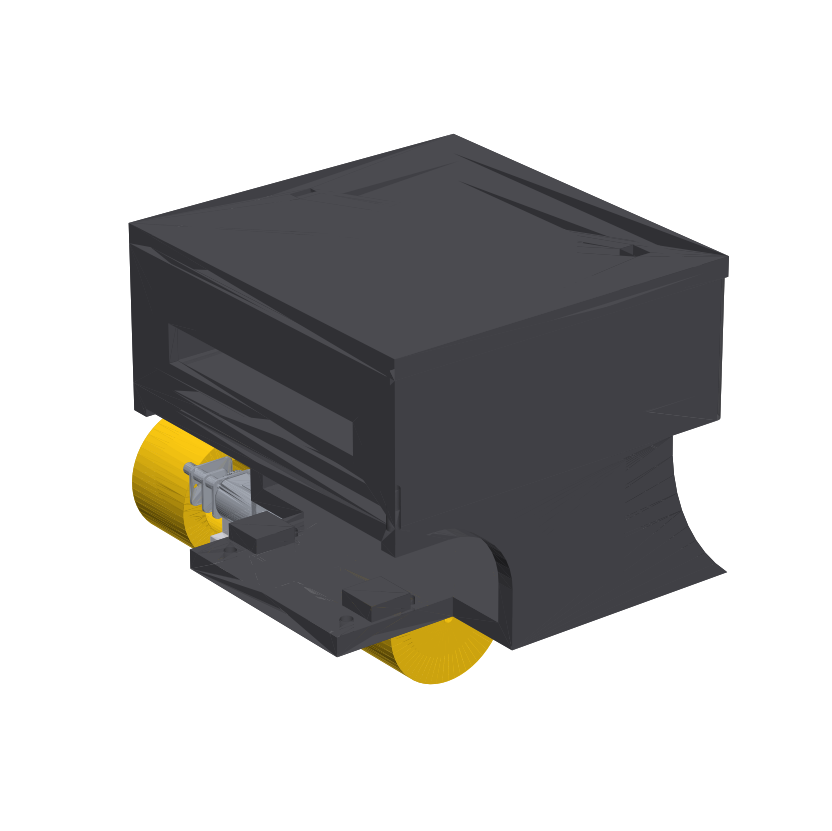</p>

---

## Resumen

CAR-LOSS es un robot minisumo (10 × 10 cm, ≈ 82 mm de alto) que se maneja con un **guante con sensor inercial** o desde una **consola web**. Todo pasa por **ROS2**.

El sistema tiene tres equipos que se comunican por **WiFi con UDP**:

- **El robot.** Una ESP32 con un lazo de control a **200 Hz** lee la IMU (MPU-6050), los encoders de cuadratura y la batería (INA219). Filtra las señales en el propio microcontrolador y controla la velocidad de cada rueda y el rumbo.
- **El guante.** Otra ESP32 con una IMU estima la inclinación de la mano a 100 Hz y la envía como orden de movimiento.
- **El PC (máquina virtual Ubuntu con ROS2).** Recibe todo y aplica **filtros de Kalman**. Además convierte las órdenes en velocidades de rueda, lleva el robot a coordenadas del dojo y publica una **consola web 3D** para operar el sistema.

Este informe se centra en dos ejes:

1. **Procesamiento digital de señales:** antialiasing, filtros IIR Butterworth, media móvil, filtro complementario, tres filtros de Kalman y estimación por cuantización de encoders.
2. **Comunicaciones:** protocolo UDP propio, descubrimiento automático, control de flujo, el grafo de ROS2 que une al robot y al guante, y el puente hacia el navegador.

---

## Índice

1. [Objetivos](#1-objetivos)
2. [Arquitectura general](#2-arquitectura-general)
3. [Hardware](#3-hardware)
4. [Procesamiento digital de señales](#4-procesamiento-digital-de-señales)
5. [Control](#5-control)
6. [Comunicaciones](#6-comunicaciones)
7. [ROS2: el sistema que une al robot y al guante](#7-ros2-el-sistema-que-une-al-robot-y-al-guante)
8. [Consola web CAR-LOSS](#8-consola-web-car-loss)
9. [Resultados](#9-resultados)
10. [Problemas encontrados y soluciones](#10-problemas-encontrados-y-soluciones)
11. [Conclusiones](#11-conclusiones)
12. [Referencias](#12-referencias)

---

## 1. Objetivos

### 1.1 General

Diseñar e implementar un robot minisumo teleoperado. El robot debe adquirir y filtrar sus señales en tiempo real, comunicarse de forma inalámbrica con un sistema ROS2 y poder manejarse con un guante inercial, mostrando su estado y sus señales de forma visual.

### 1.2 Específicos

- Muestrear la IMU y los encoders del robot a 200 Hz con un periodo determinista, y filtrarlos dentro del microcontrolador con un costo de cómputo medido.
- Diseñar e implementar filtros digitales (IIR, media móvil, complementario) y compararlos con filtros de Kalman aplicados en el PC.
- Diseñar un protocolo de comunicación UDP robusto ante una red WiFi intermitente, con descubrimiento automático de los equipos.
- Integrar el robot y el guante en un grafo de ROS2, con cinemática diferencial, registro de datos y visualización.
- Controlar la velocidad de las ruedas y el rumbo para que el robot vaya recto y se recupere de perturbaciones.
- Llevar el robot a coordenadas del dojo indicadas por el operador.

---

## 2. Arquitectura general

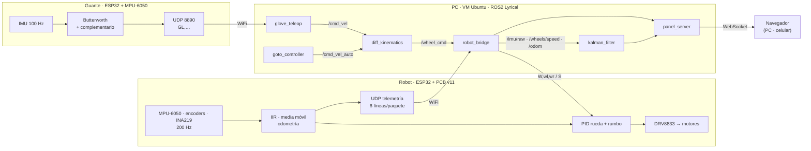

| Subsistema | Plataforma | Frecuencia | Función |
|---|---|---|---|
| Robot | ESP32 DevKit V1, FreeRTOS (ESP-IDF 5.3.1) | lazo de 200 Hz en el núcleo 1 | Sensado, filtrado, control y telemetría |
| Guante | ESP32 DevKit + MPU-6050 | 100 Hz de muestreo, 50 Hz de envío | Ángulos de la mano → orden de movimiento |
| PC | VM Ubuntu 26.04 + ROS2 Lyrical (VirtualBox) | 20–50 Hz por nodo | Puente, Kalman, cinemática, navegación y consola web |

---

## 3. Hardware

### 3.1 Robot (PCB v11, una cara)

| Bloque | Componente | Detalle |
|---|---|---|
| Procesador | ESP32 DevKit V1 | Dos núcleos: WiFi en el núcleo 0 y control en el núcleo 1 |
| Puente H | DRV8833 | PWM de 20 kHz y 10 bits en los pines IN, *slow decay* |
| Motores | 2 motorreductores ≈100:1 | Encoder magnético de cuadratura de 7 pulsos → **2771 cuentas/vuelta** (medido) |
| Ruedas | Ø 30 mm (radio efectivo 16,2 mm) | Separación entre ruedas de **79 mm** (ensamblaje de SolidWorks) |
| IMU | MPU-6050 (I²C 0x68) | ±2 g, ±250 °/s, DLPF interno de 94 Hz |
| Batería | 2S Li-ion (7,4–8,4 V) | Medida con el **INA219** (shunt de 0,1 Ω) |

<p align="center">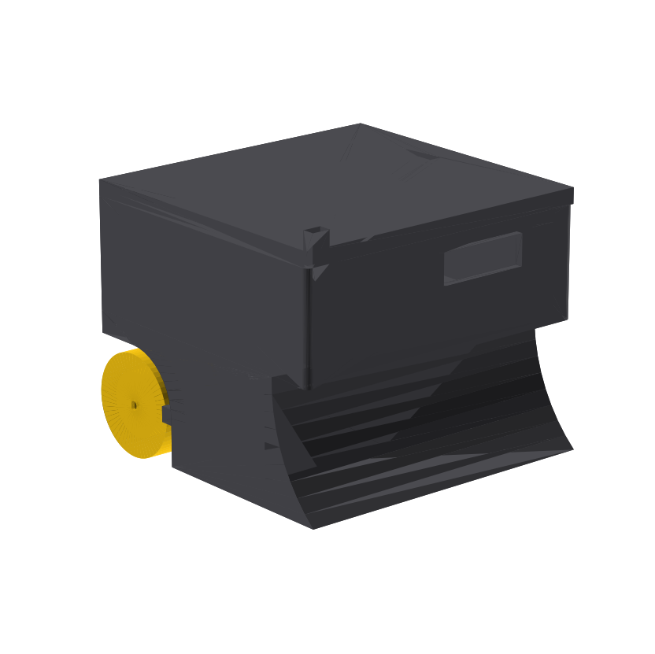</p>

### 3.2 Guante

Una ESP32 DevKit y un MPU-6050 en el dorso de la mano. El botón **BOOT** fija la posición neutra de la mano. El guante transmite por WiFi a 50 paquetes/s.

---

## 4. Procesamiento digital de señales

Esta es la parte central del proyecto. Cada señal recorre una **cadena de procesamiento** diseñada según su naturaleza: ancho de banda, tipo de ruido y retardo admisible para el control.

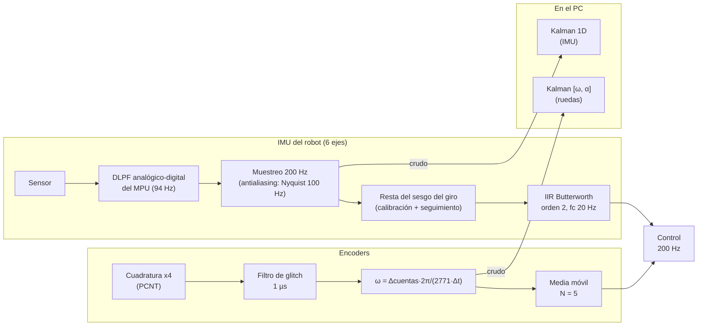

### 4.1 Muestreo y antialiasing

- **Frecuencia de muestreo:** el lazo del robot corre a **fs = 200 Hz**, con periodo Ts = 5 ms. Lo marca `vTaskDelayUntil` en una tarea de FreeRTOS fijada al núcleo 1, así que el periodo no depende del WiFi.
- **Ancho de banda útil:** la dinámica de un robot de este tamaño (aceleraciones, giros, choques) tiene su información por debajo de ≈10–20 Hz.
- **Antialiasing:** antes del muestreo, el filtro digital interno del MPU-6050 (DLPF, modo 2) limita la banda a ≈94 Hz, por debajo de la frecuencia de Nyquist fs/2 = 100 Hz. Así la vibración de los motores no se pliega en la banda útil. El guante muestrea a 100 Hz con el DLPF en 44 Hz (Nyquist de 50 Hz).
- **Sesgo del giroscopio:** se estima al arrancar con 400 muestras (2 s), y se repite si la desviación supera 0,5 °/s, porque eso indica que el robot se movió. Mientras el robot está quieto, el sesgo se reajusta lentamente con un IIR de primer orden (α = 0,002, τ ≈ 2,5 s) para seguir la deriva térmica.

### 4.2 IIR Butterworth de orden 2 (IMU)

Se eligió Butterworth por su **respuesta máximamente plana** en la banda de paso. Se diseñó con la transformada bilineal (`butter(2, 20/(200/2))`) y se implementó como una sección de segundo orden (*biquad*) en **forma directa II transpuesta**, que es numéricamente estable en `float`:

$$
H(z)=\frac{b_0+b_1z^{-1}+b_2z^{-2}}{1+a_1z^{-1}+a_2z^{-2}}
\qquad
\begin{aligned}
y[n]&=b_0x[n]+s_1[n-1]\\
s_1[n]&=b_1x[n]-a_1y[n]+s_2[n-1]\\
s_2[n]&=b_2x[n]-a_2y[n]
\end{aligned}
$$

| Coeficiente | Valor |
|---|---|
| b₀, b₁, b₂ | 0,067455 · 0,134911 · 0,067455 |
| a₁, a₂ | −1,142981 · 0,412802 |

Los mismos coeficientes producen fc = 20 Hz en el robot (fs = 200 Hz) y **fc = 10 Hz en el guante** (fs = 100 Hz), porque el corte es relativo a fs.

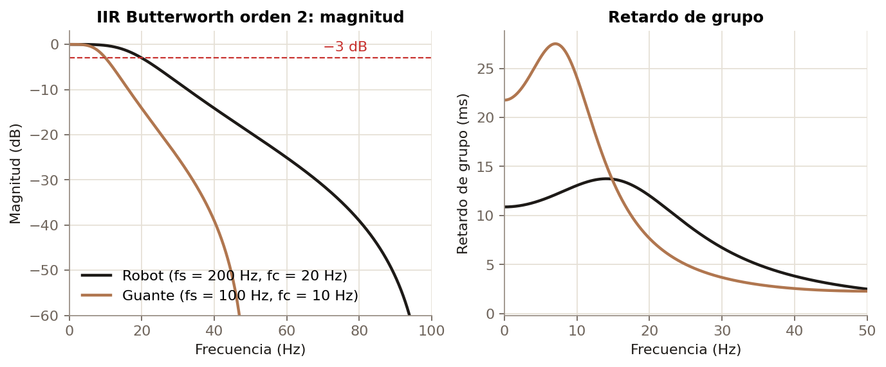

| Frecuencia (robot) | Ganancia |
|---|---|
| 10 Hz | −0,24 dB |
| 20 Hz | −3 dB (corte) |
| 50 Hz | −19,6 dB |
| 100 Hz | cero de transmisión (−∞) |

- **Retardo de grupo** en baja frecuencia: ≈11 ms en el robot. Es pequeño frente a la dinámica mecánica, así que el lazo de control lo tolera.
- **Costo:** 5 multiplicaciones y 4 sumas por canal y muestra. El filtrado completo (6 canales IIR y 2 medias móviles) se cronometra en cada ciclo y se envía en la columna `filt_us` de la telemetría.

### 4.3 Velocidad de las ruedas: cuantización y media móvil

Los encoders se leen con el contador de pulsos por hardware de la ESP32 (**PCNT**) en modo cuadratura ×4. Ese modo cuenta los cuatro flancos de las dos fases y da el sentido de giro sin depender del PWM. Un filtro de *glitch* de 1 µs descarta pulsos de ruido de las escobillas.

La velocidad se calcula por diferencia de cuentas en cada periodo:

$$
\omega[n]=\frac{2\pi}{2771}\cdot\frac{c[n]-c[n-1]}{T_s}
\quad\Rightarrow\quad
\Delta\omega_{min}=\frac{2\pi\cdot 200}{2771}\approx 0{,}45\ \text{rad/s}
$$

Ese es el **escalón de cuantización**: una sola cuenta de diferencia equivale a 0,45 rad/s. Para suavizarlo sin retrasar el PID se usa una **media móvil de N = 5 muestras**, un FIR con coeficientes 1/N:

$$
y[n]=\frac{1}{N}\sum_{k=0}^{N-1}x[n-k],
\qquad
|H(f)|=\left|\frac{\sin(\pi fN/f_s)}{N\sin(\pi f/f_s)}\right|
$$

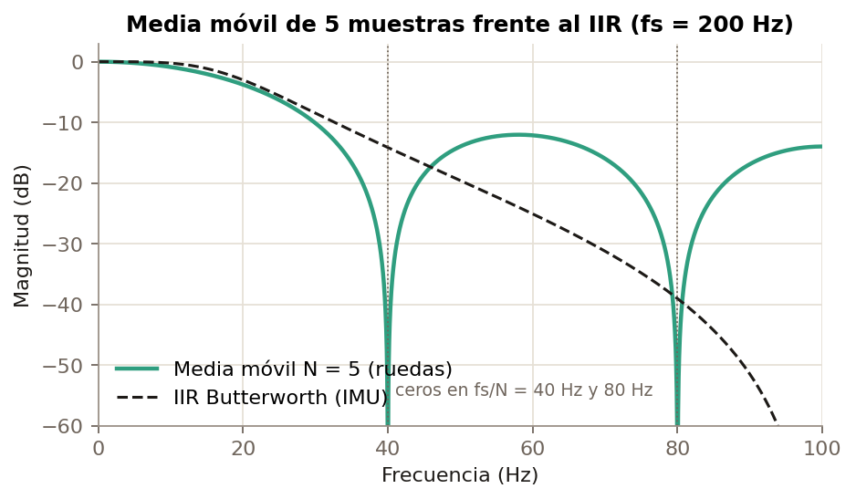

| Característica | Valor |
|---|---|
| Ventana | 25 ms |
| Retardo (fase lineal) | (N−1)/2 = 2 muestras = 10 ms |
| Ceros | múltiplos de fs/N = 40 Hz |
| Costo | O(1) por muestra: acumulador + buffer circular |

**¿Por qué IIR y media móvil, y no FIR largos ni filtros adaptativos?** En las prácticas anteriores se compararon FIR, IIR y adaptativos. Para la misma banda de transición, un FIR necesita muchos más coeficientes: más memoria, más cómputo y más retardo. Los adaptativos fueron los de peor desempeño con estas señales. En un lazo de 5 ms, el IIR de orden 2 y la media móvil dan la mejor relación entre atenuación, retardo y costo.

### 4.4 Filtro complementario (guante y rumbo del robot)

El acelerómetro da el ángulo de la mano sin deriva, pero con ruido. El giroscopio, integrado, es suave pero deriva. El **filtro complementario** combina lo mejor de los dos:

$$
\theta[n]=\alpha\big(\theta[n-1]+\dot\theta_{gyro}\,\Delta t\big)+(1-\alpha)\,\theta_{acc}[n],
\qquad
f_c=\frac{1-\alpha}{2\pi\alpha\Delta t}
$$

Con α = 0,98 y Δt = 10 ms, **fc ≈ 0,32 Hz**:

- **El acelerómetro** pasa por un **pasa-bajos**: aporta la referencia lenta.
- **El giroscopio integrado** pasa por un **pasa-altos**: aporta los movimientos rápidos.

Las dos funciones de transferencia **suman 1**, así que la señal no se distorsiona.

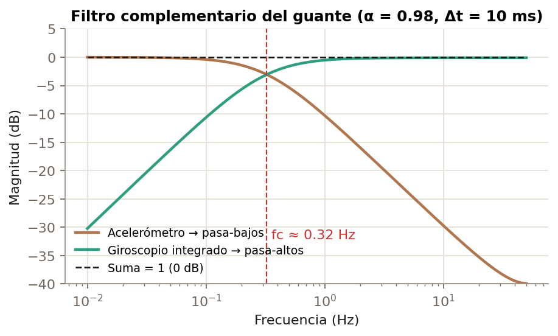

Después del complementario, un IIR de primer orden (α = 0,25) quita el temblor de la mano antes de convertir el ángulo en una orden de movimiento. El robot usa la misma idea para su **rumbo**: fusiona el giroscopio con el giro que miden los encoders, con α = 0,98.

### 4.5 Filtros de Kalman (en el PC)

El nodo `kalman_filter` aplica tres filtros de Kalman sobre las **señales crudas** que llegan del robot y del guante. Así se pueden comparar en vivo con los filtros del microcontrolador.

En todos el ciclo es el mismo:
- **Predicción:** x̂⁻ = F x̂, P⁻ = F P Fᵀ + Q.
- **Corrección:** K = P⁻Hᵀ(H P⁻Hᵀ + R)⁻¹, x̂ = x̂⁻ + K(z − H x̂⁻), P = (I − K H) P⁻.

| Señal | Estado | Modelo | Q / R |
|---|---|---|---|
| IMU (6 ejes, robot y guante) | x (1 estado) | paseo aleatorio x_k = x_{k−1} + w | Q = 0,005, R = 0,25 (m/s²)² · Q = 2·10⁻⁵, R = 8·10⁻⁵ (rad/s)² |
| Velocidad de cada rueda | [ω, α] | velocidad constante + aceleración aleatoria, F = [[1, Δt],[0, 1]] | q = 50 (rad/s²)²·s, R = 0,16 (rad/s)² |
| Cabeceo y alabeo de la mano | [θ, sesgo] | θ_k = θ + (ω_gyro − sesgo)Δt; mide θ_acc | Q_θ = 0,01, Q_sesgo = 0,003, R = 0,5 |

**Interpretación:** Q mide cuánto se espera que cambie el estado real y R cuánto ruido tiene la medida. Con el sensor quieto, **R ≈ varianza del ruido** (la σ cruda que muestra la consola, al cuadrado). Una Q alta hace que el filtro siga más rápido pero filtre menos.

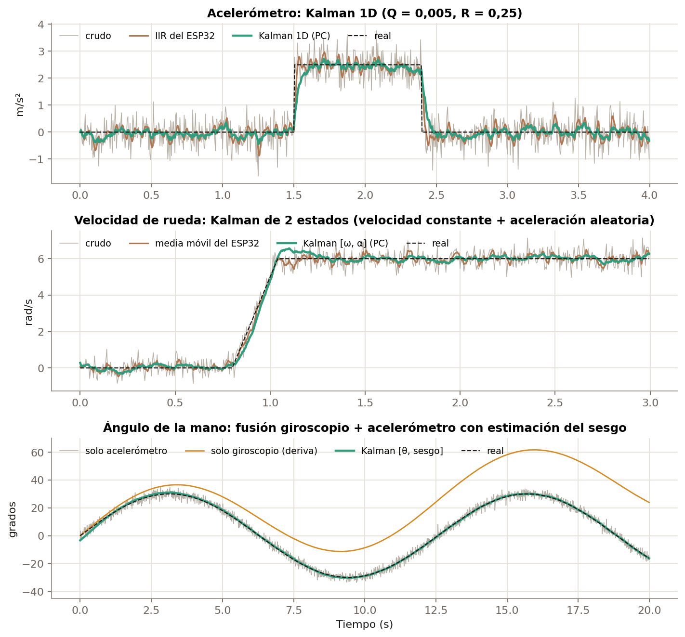

Resultados con señales de prueba de ruido conocido, usando las mismas clases del nodo de ROS2:

| Señal | Ruido crudo | Filtro del ESP32 | **Kalman** |
|---|---|---|---|
| Acelerómetro (σ) | 0,45 m/s² | IIR: 0,20 m/s² | **0,12 m/s²** |
| Velocidad de rueda (σ del error) | 0,42 rad/s | media móvil: 0,20 rad/s | **0,12 rad/s** |
| Ángulo de la mano (RMS) | 2,03° (solo acelerómetro) | — | **0,21°**, sesgo estimado 2,07 °/s (real 2,00) |

El Kalman de ángulo es el caso más interesante. Además del ángulo **estima el sesgo del giroscopio** y lo corrige, mientras que integrar el giroscopio solo deriva sin límite (curva naranja).

### 4.6 Odometría

El robot integra la pose en el propio microcontrolador:

$$
v=\frac{R(\omega_R+\omega_L)}{2},\quad
\omega=\frac{R(\omega_R-\omega_L)}{B},\quad
x_{k+1}=x_k+v\cos\theta\,T_s,\quad
y_{k+1}=y_k+v\sin\theta\,T_s
$$

- **R** = 16,2 mm es el radio efectivo. Se calibró con un recorrido recto medido: 33 cm.
- **B** = 79 mm es la separación entre ruedas.
- **El rumbo θ** combina el giroscopio con los encoders (§4.4), porque los encoders sobreestiman el giro cuando una rueda patina.

---

## 5. Control

### 5.1 Velocidad de cada rueda: PI con prealimentación

A partir de la curva medida de los motores se obtuvo una **prealimentación** que deja al PI solo una corrección pequeña:

$$
d=\underbrace{k_{ff}\,\omega_{ref}+d_{min}}_{\text{prealimentación}}+k_p e+k_i\!\int e\,dt,
\qquad |d-d_{ff}|\le 0{,}15
$$

| Parámetro | Valor |
|---|---|
| k_ff | 0,045 (ciclo útil por rad/s) |
| d_min | 0,052 (izquierdo) · 0,041 (derecho), zona muerta de cada motor |
| k_p, k_i | 0,02 · 0,4 |
| Antiwindup | integra solo si no satura |

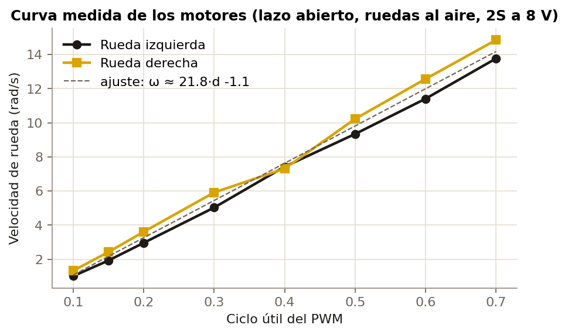

La curva es casi lineal, ≈21 rad/s por unidad de ciclo útil. El techo es **≈14 rad/s por rueda (≈0,22 m/s)** con PWM_MAX = 0,70. Ese límite existe porque los motores son de 6 V y la batería 2S da 8,4 V.

### 5.2 Rumbo: control en cascada que mantiene el ángulo

Un lazo externo compara el giro pedido con el que mide el giroscopio y **corrige las velocidades de referencia** de las ruedas, no el PWM. Así el PID de cada rueda cumple la corrección en lugar de deshacerla:

$$
c=k_p\,e_{\dot\theta}+k_i\,e_\theta+k_b\!\int e_\theta\,dt,
\qquad
\omega_{L,ref}\mathrel{-}=c,\quad \omega_{R,ref}\mathrel{+}=c
$$

- **k_p = 1,5** amortigua el giro.
- **k_i = 40** devuelve el robot al ángulo original.
- **k_b = 20** absorbe la diferencia constante entre ruedas (por ejemplo, el patinaje).

La primera versión solo controlaba la velocidad de giro y guardaba el error de ángulo en un integrador saturado. Después de un empujón, el robot frenaba el giro pero **quedaba torcido**. La versión final guarda el error de ángulo sin saturar:

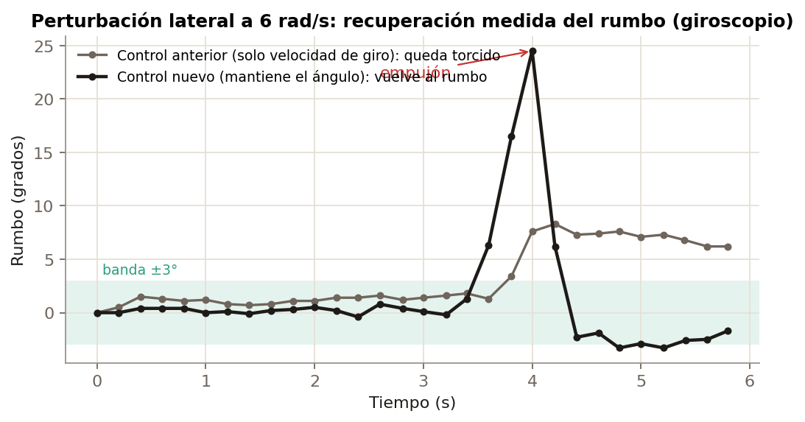

En la figura, con datos medidos con el giroscopio del robot real:

| Control | Tras el empujón |
|---|---|
| Anterior | queda en +7° hasta el final |
| **Nuevo** | **vuelve a menos de 3° en ≈0,3 s**, con un sobrepaso de −3° que se corrige solo |

### 5.3 Ir a un punto del dojo

El nodo `goto_controller` lleva el robot a una coordenada (x, y) con un controlador de uniciclo en lazo cerrado sobre `/odom`:

- Si el error de rumbo es mayor de 35°, **gira en el sitio** hacia el punto.
- Si no, **avanza** con v = k_v·d·cos(e) y corrige con ω = k_w·e.
- **Llega** cuando d < 2 cm.
- **Rechaza** puntos fuera del área segura (r > 31 cm).
- **Se cancela** con la parada de emergencia.

---

## 6. Comunicaciones

### 6.1 ¿Por qué UDP sobre WiFi?

| Criterio | TCP | **UDP (elegido)** |
|---|---|---|
| Latencia | retransmite y espera: picos de cientos de ms | el dato nuevo reemplaza al perdido |
| Telemetría a 200 Hz | un paquete perdido bloquea a los siguientes | se pierde una muestra y sigue |
| Órdenes de movimiento | llegan tarde | llegan a tiempo o se descartan; un tiempo límite en el robot lo detiene |

Para control en tiempo real **un dato viejo no sirve**, así que es mejor perderlo que esperarlo. La robustez se agrega por encima de UDP: tiempos límite, reenvío periódico de órdenes, descubrimiento automático y control de flujo.

### 6.2 Protocolo del robot

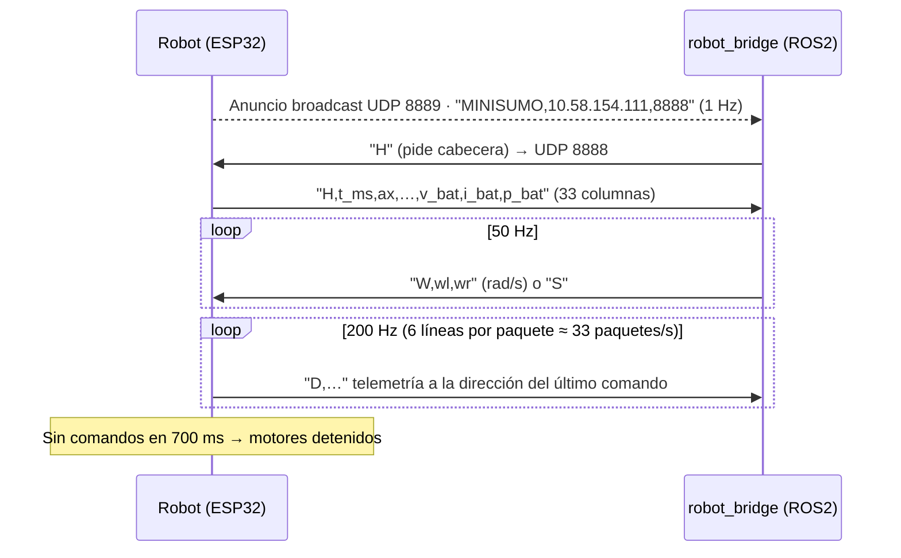

| Comando | Significado |
|---|---|
| `W,wl,wr` | velocidad de cada rueda (rad/s), con PID |
| `M,dl,dr` | ciclo útil directo, lazo abierto |
| `S` / `P` | detener / mantener vivo |
| `G,kp,ki,kd,kff` · `F,dl,dr,trim` · `Y,kp,ki,kb` | ganancias en vivo |
| `R` · `C` · `T` · `H` | reiniciar odometría · recalibrar giroscopio · autodiagnóstico · pedir cabecera |

**Formato de la telemetría:** líneas de texto CSV con 33 columnas:
- IMU cruda y filtrada;
- velocidad medida, filtrada y pedida de cada rueda;
- ciclo útil y ticks de los encoders;
- pose x, y, θ y rumbos parciales;
- tiempo de filtrado (`filt_us`), modo y batería.

**Ancho de banda y paquetes:** se envían 6 líneas por datagrama, a ≈240 B por línea:
- Así ningún datagrama supera **1472 B** (la MTU de 1500 menos las cabeceras IP y UDP), y no hay fragmentación.
- Salen ≈33 datagramas/s, unos **48 kB/s (≈0,4 Mbit/s)**. Mandar una línea por datagrama generaría 200 datagramas/s y mucho más trabajo para la radio.
- El puente reconstruye las columnas **por nombre** a partir de la cabecera. Así el firmware puede agregar columnas sin romper ROS2.

### 6.3 Protocolo del guante

- El guante emite `GL,t,pitch,roll,pitch_raw,roll_raw,ax…gz,ax_f…gz_f` a **50 paquetes/s**.
- Al principio va por **broadcast**: por el hotspot de un celular llegaban solo **6–14 de 50 paquetes/s**, porque los hotspots retienen el broadcast.
- Cuando `glove_teleop` lo recibe, responde `GLP` y el guante pasa a **unicast directo** al PC: llegan ≈50/s.
- Si el PC deja de responder 3 s, el guante vuelve a broadcast.

### 6.4 Red y puesta en marcha

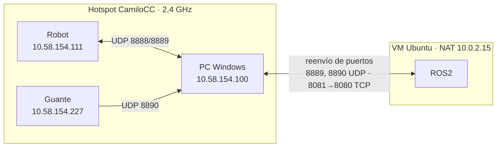

Decisiones de red tomadas con problemas reales:

- **2,4 GHz obligatorio:** la ESP32 no tiene radio de 5 GHz. El hotspot se configuró en 2,4 GHz.
- **Ahorro de energía del WiFi desactivado** (`WIFI_PS_NONE`) en el robot y el guante. Con el ahorro, la radio duerme entre balizas y la latencia sube a cientos de ms.
- **VM en NAT con reenvío de puertos:** algunos hotspots de celular **descartan el tráfico de la VM en modo puente**, porque solo aceptan la dirección MAC del equipo asociado. En NAT, la VM sale por la IP del PC. La telemetría vuelve porque el robot responde a quien le envió el último comando.
- **Descubrimiento automático:** el robot se anuncia por broadcast y el puente lo sigue si cambia de IP, por ejemplo cuando el hotspot cambia de subred.

### 6.5 Robustez

| Mecanismo | Dónde | Qué evita |
|---|---|---|
| Tiempo límite de 700 ms | robot | que siga moviéndose si se cae el WiFi |
| Reenvío de órdenes a 50 Hz | robot_bridge | que una pérdida suelta lo detenga |
| Parada de emergencia `/estop` | robot_bridge | el guante o el pad no pueden mover el robot mientras está activa |
| Reinicio automático de nodos | launch (`respawn`) | que un nodo caído deje al sistema sin telemetría |
| Control de flujo con ACK | panel_server ↔ navegador | colas de varios segundos en navegadores lentos |

---

## 7. ROS2: el sistema que une al robot y al guante

### 7.1 Grafo de nodos y tópicos

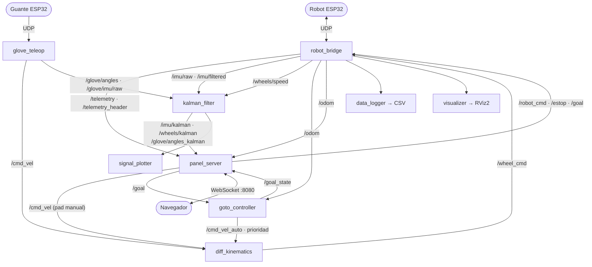

| Nodo | Entrada | Salida | Función |
|---|---|---|---|
| `robot_bridge` | UDP del robot, `/wheel_cmd`, `/robot_cmd`, `/estop` | `/telemetry`, `/imu/raw`, `/imu/filtered`, `/wheels/speed`, `/odom` | Puente UDP ↔ ROS2, descubrimiento y parada de emergencia |
| `glove_teleop` | UDP del guante | `/cmd_vel`, `/glove/angles`, `/glove/imu/*` | Inclinación de la mano → velocidad lineal y angular, con zona muerta |
| `diff_kinematics` | `/cmd_vel`, `/cmd_vel_auto` | `/wheel_cmd` | Cinemática inversa ω_L,R = (v ∓ ωB/2)/R, con saturación que conserva el radio de giro |
| `kalman_filter` | señales crudas | `/imu/kalman`, `/wheels/kalman`, `/glove/*_kalman` | Los tres filtros de Kalman (§4.5) |
| `goto_controller` | `/goal`, `/odom`, `/estop` | `/cmd_vel_auto`, `/goal_state` | Ir a un punto del dojo |
| `panel_server` | todos los anteriores | WebSocket, `/robot_cmd`, `/estop`, `/goal` | Consola web (§8) |
| `data_logger` | `/telemetry` | CSV en `~/minisumo_datos/` | Registro para análisis |
| `visualizer`, `signal_plotter` | `/odom`, señales | RViz2, matplotlib | Herramientas de respaldo |

### 7.2 Prioridad de las órdenes

El robot recibe órdenes de tres fuentes: el guante, el pad manual y el control automático. `diff_kinematics` las ordena así:
1. **`/cmd_vel_auto`** (ir a un punto) manda mientras esté activo.
2. **`/cmd_vel`** (guante o pad) se ignora mientras el control automático tenga la prioridad, hasta 0,3 s después de su última orden.
3. **`/estop`** está por encima de todo: el puente envía `S` aunque lleguen órdenes.

### 7.3 Lanzamiento

Todo el sistema arranca con un solo comando. Los nodos críticos se reinician solos si fallan:

```bash
ros2 launch minisumo_ros visualizacion.launch.py guante:=true rviz:=false
```

---

## 8. Consola web CAR-LOSS

La consola reemplaza a RViz y a las gráficas de matplotlib para el uso diario. Funciona en el navegador del PC o del celular, sin internet: three.js y las fuentes van incluidos en el paquete.

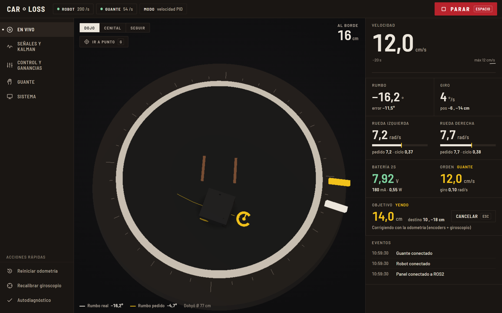

| Sección | Contenido |
|---|---|
| **En vivo** | Robot 3D (CAD de SolidWorks) sobre el dojo, trayectoria y rumbo real/pedido en el borde. El tramo del borde se pone ámbar a 12 cm y rojo a 6 cm de la salida. Telemetría y registro de eventos (detecta empujones y mide su recuperación) |
| **Señales y Kalman** | Seis gráficas en vivo: crudo frente a Kalman, con σ y % de reducción. Opción de comparar con el filtro del ESP32. Pausa y exportación a CSV y PNG |
| **Control y ganancias** | Ajuste en vivo de PID (G), rumbo (Y) y zona muerta (F). Pad de manejo manual (también con W A S D) |
| **Guante** | Diales de cabeceo y alabeo, vector de la orden y gráfica crudo frente a Kalman |
| **Sistema** | Enlaces y tasas, batería de la sesión, datos del robot y direcciones para abrir desde otro equipo |

| | |
|---|---|
| 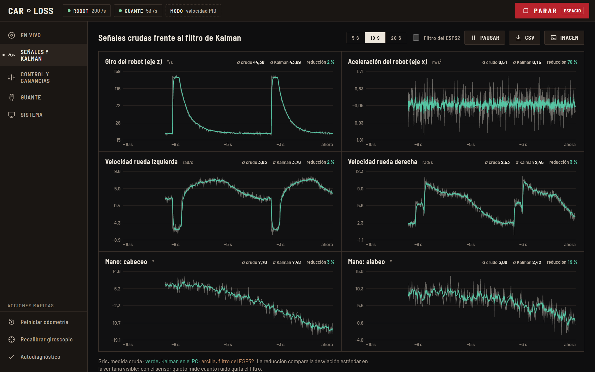 | 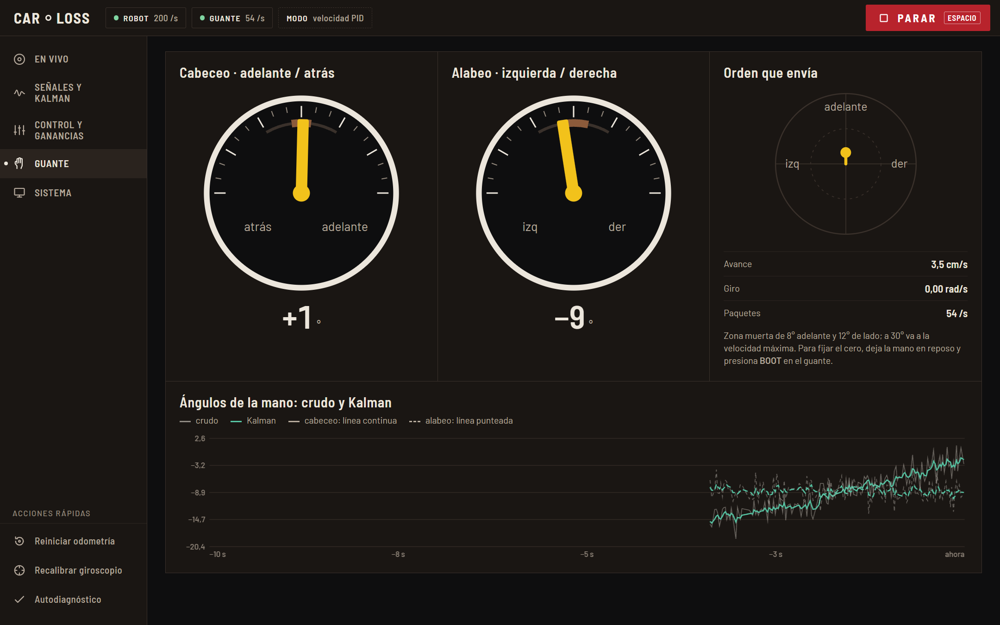 |
| 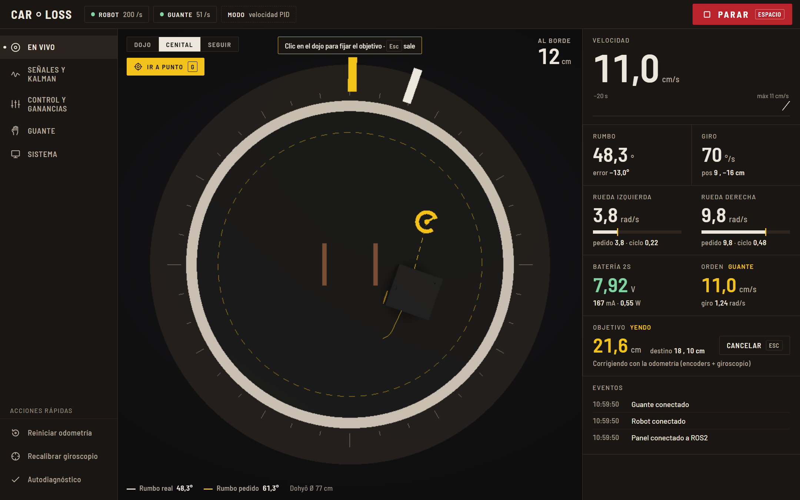 | 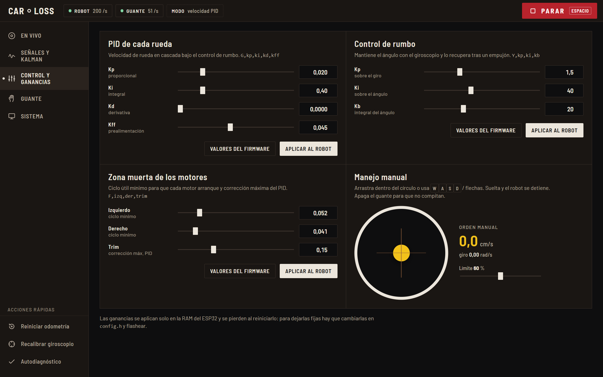 |

**Comunicación con el navegador:**
- `panel_server` es un nodo de ROS2 con servidor HTTP y WebSocket escrito solo con la biblioteca estándar de Python (RFC 6455), sin rosbridge.
- Envía un **resumen de estado a 25 Hz** en lugar de reenviar los tópicos de 200 Hz.
- Usa **control de flujo con confirmación**: el siguiente estado sale solo cuando el navegador confirma el anterior. Así nunca se acumula una cola, aunque el navegador dibuje lento (Firefox sin tarjeta gráfica en la VM).
- Las series de las gráficas viajan **solo cuando la vista las pide**.

---

## 9. Resultados

| Medida | Resultado |
|---|---|
| Telemetría recibida en ROS2 | **≈200 muestras/s** (la tasa completa del lazo) |
| Paquetes del guante | **≈50/s** (unicast) |
| Lazo de control | 200 Hz sin excesos de tiempo; filtrado de los 8 canales en microsegundos (`filt_us`) |
| Velocidad máxima | ≈14 rad/s por rueda, ≈0,22 m/s |
| Ir recto (6 rad/s) | rumbo entre −0,4° y +0,8° antes de la perturbación (control de rumbo activo) |
| Recuperación tras un empujón de +27° | **< 3° en ≈0,3 s** (antes: quedaba en +7°) |
| Reducción de ruido del Kalman | acelerómetro −74 % · ruedas −71 % · ángulo de la mano: error 2,03° → 0,21° |
| Ir a un punto | llega con < 2 cm de error de odometría (prueba simulada en la consola) |
| Consola web | ≈22 estados/s al navegador, sin cola y sin retraso apreciable |

---

## 10. Problemas encontrados y soluciones

| Problema | Diagnóstico | Solución |
|---|---|---|
| Las velocidades medidas no coincidían con el recorrido real | Las cuentas por vuelta supuestas (1496) eran incorrectas para los encoders magnéticos | Se midieron con 10 vueltas a mano por rueda: **2771 cuentas/vuelta** |
| Una rueda contaba 1,28 veces más que la otra yendo recto | Patinaje de la rueda izquierda (el giroscopio confirmó que iba recto) | El rumbo lo manda el giroscopio. Se calibró el radio efectivo con un recorrido medido |
| Tras un empujón el robot quedaba torcido | El integrador del rumbo se saturaba y perdía la memoria del ángulo | Control que mantiene el ángulo, con integral lenta separada (§5.2) |
| El robot no se conectaba al hotspot | El hotspot pasó a 5 GHz y la ESP32 solo usa 2,4 GHz | Hotspot en 2,4 GHz |
| La VM no recibía IP en algunos hotspots | El hotspot descarta el tráfico de la VM en modo puente | VM en NAT con reenvío de puertos |
| La consola mostraba datos con segundos de retraso | El servidor enviaba sin esperar al navegador y se formaba una cola | Control de flujo con ACK y series bajo demanda |
| Tras "Detener" se perdía la telemetría | El nodo se caía: `.warn()` ya no existe en el logger de ROS2 Lyrical | `.warning()` y reinicio automático de los nodos críticos |
| El guante llegaba a 0 paquetes/s | Un lanzamiento anterior no se cerró y su nodo se quedaba con el puerto | Cierre completo antes de lanzar; un solo lanzamiento |
| No se podía flashear con el MPU puesto | El MPU en el bus I²C interfiere con el arranque en modo de carga | Se retira el MPU para flashear |

---

## 11. Conclusiones

- **El filtrado en el microcontrolador** (Butterworth de orden 2 y media móvil de 5 muestras) es suficiente para el control a 200 Hz, con un retardo de 10–11 ms y un costo de cómputo despreciable. El antialiasing del MPU antes de Nyquist evita que la vibración de los motores se pliegue en la banda útil.
- **Los filtros de Kalman** reducen más el ruido (≈70 % frente a ≈55 % de los filtros del ESP32) con poco retardo, porque usan un modelo de la señal. El Kalman de ángulo además **estima el sesgo del giroscopio**, algo que ningún filtro lineal fijo puede hacer. Correrlos en el PC permite compararlos en vivo sin cargar el microcontrolador.
- **La cuantización de los encoders** (0,45 rad/s por cuenta a 200 Hz) es la principal fuente de ruido de la velocidad. Por eso conviene filtrar en el dominio de la velocidad y no derivar más.
- **En comunicaciones**, UDP con tiempos límite, descubrimiento automático, envío unicast y control de flujo resultó más robusto que confiar en la red: el sistema sigue funcionando con un hotspot de celular inestable.
- **ROS2** permitió separar responsabilidades: puente, cinemática, filtros, navegación y consola. Por eso se pudieron agregar funciones (Kalman, ir a un punto, consola web) sin tocar el firmware.
- **Medir antes de ajustar fue clave.** Las cuentas por vuelta, el radio efectivo, la curva de los motores y la recuperación de rumbo se midieron, y cada problema se resolvió con datos.

---

## 12. Referencias

1. A. V. Oppenheim, R. W. Schafer. *Discrete-Time Signal Processing*, 3.ª ed. Pearson, 2010.
2. R. E. Kalman. "A New Approach to Linear Filtering and Prediction Problems". *ASME J. Basic Eng.*, 1960.
3. G. Welch, G. Bishop. *An Introduction to the Kalman Filter*. UNC-Chapel Hill, TR 95-041.
4. S. O. H. Madgwick. Notas sobre filtros complementarios para orientación con IMU, 2010.
5. R. Siegwart, I. Nourbakhsh. *Introduction to Autonomous Mobile Robots*. MIT Press, 2011.
6. Espressif Systems. *ESP-IDF Programming Guide v5.3* (PCNT, LEDC, Wi-Fi).
7. InvenSense. *MPU-6000/6050 Register Map and Descriptions*, rev. 4.2.
8. Texas Instruments. *DRV8833 Dual H-Bridge Motor Driver* · *INA219 Current/Power Monitor*.
9. Open Robotics. *ROS 2 Documentation*.
10. IETF RFC 768 (UDP) · RFC 6455 (WebSocket).

---

<sub>Figuras generadas con `herramientas/figuras_informe.py` a partir de los coeficientes del firmware, las clases de `kalman_filter.py` y los datos medidos en las pruebas. Las capturas de la consola se tomaron con datos simulados por el servidor real del panel.</sub>
