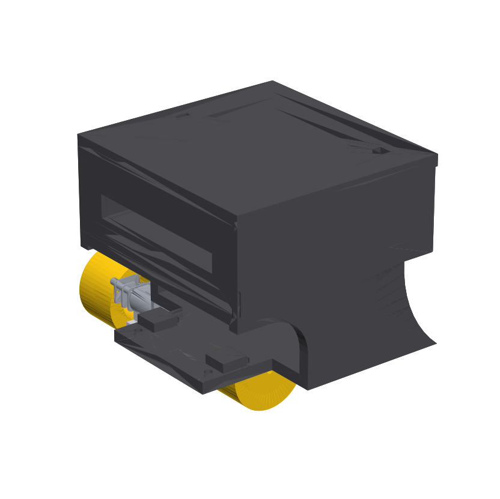
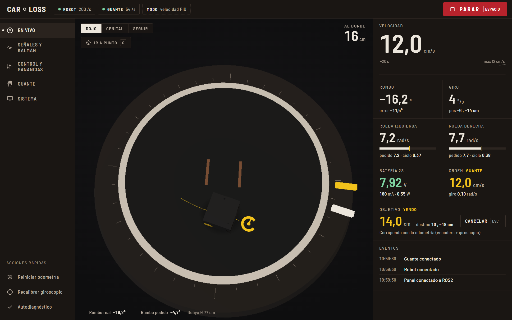
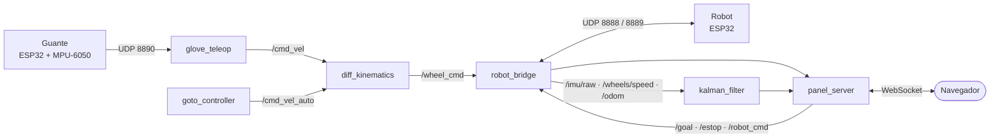

<h1 align="center">CAR-LOSS · Minisumo teleoperado con ROS2</h1>

<p align="center">
  
</p>

<p align="center">
  Robot minisumo con <b>ESP32</b> que se maneja con un <b>guante inercial</b> o desde una <b>consola web 3D</b>, integrado con <b>ROS2</b>.<br>
  Filtrado digital en el microcontrolador, <b>filtros de Kalman</b> en el PC, control de rumbo con giroscopio y navegación a coordenadas del dojo.
</p>

<p align="center">
  <a href="INFORME.md"><b>Informe técnico</b></a> ·
  <a href="docs/Manual_de_usuario_CAR-LOSS.pdf"><b>Manual de usuario (PDF)</b></a> ·
  <a href="#puesta-en-marcha"><b>Puesta en marcha</b></a>
</p>

---



## Qué hace

- **Robot (ESP32 + PCB propia):**
  - Lee la IMU, los encoders de cuadratura y la batería a **200 Hz**.
  - Filtra en el microcontrolador: **IIR Butterworth** para la IMU y **media móvil** para las ruedas.
  - Controla cada rueda con un **PI con prealimentación** y **mantiene el rumbo** con el giroscopio. Tras un empujón de +27° vuelve a su rumbo en ≈0,3 s.
- **Guante (ESP32 + MPU-6050):** estima la inclinación de la mano con un **filtro complementario** y la envía como orden de movimiento.
- **ROS2:**
  - Puente UDP con el robot, cinemática diferencial y **tres filtros de Kalman**.
  - **Ir a un punto** con un clic en el dojo, registro de datos y RViz2.
- **Consola web:**
  - Robot 3D del CAD sobre el dojo, telemetría y gráficas crudo frente a Kalman.
  - Ajuste de ganancias en vivo, manejo manual y parada de emergencia.
  - Funciona en el PC o en el celular, sin internet.

## Arquitectura



| Nodo | Función |
|---|---|
| `robot_bridge` | Encuentra el robot por su anuncio UDP, le envía la velocidad de cada rueda y publica la telemetría. Atiende la parada de emergencia |
| `glove_teleop` | Inclinación de la mano → `/cmd_vel` |
| `diff_kinematics` | (v, ω) → velocidad de cada rueda. Da prioridad al control automático |
| `kalman_filter` | Kalman de la IMU, de las ruedas [ω, α] y de los ángulos de la mano [θ, sesgo] |
| `goto_controller` | Lleva el robot a una coordenada (x, y) del dojo |
| `panel_server` | Consola web: HTTP + WebSocket con la biblioteca estándar de Python, sin rosbridge |
| `data_logger` · `routines` · `visualizer` · `signal_plotter` | CSV, rutinas de prueba, RViz2 y gráficas de matplotlib |

## Estructura del repositorio

```
firmware/
  robot_esp32/     Firmware del robot (ESP-IDF 5.3.1, FreeRTOS): control a 200 Hz, filtros, UDP
  guante/          Firmware del guante: complementario + Butterworth, UDP
  robot/           Primera versión del robot (ESP32-C3), histórica
ros2/minisumo_ros/ Paquete ROS2: nodos, launch, consola web (web/) y modelo 3D (meshes/)
pcb/               PCB v11 en KiCad
herramientas/      cad2rviz.py (STL de SolidWorks → ROS) y figuras_informe.py
docs/              Manual de usuario (PDF), imágenes y diagrama de cableado
INFORME.md         Informe técnico (procesamiento de señales y comunicaciones)
```

## Hardware

| Bloque | Componente |
|---|---|
| Robot | ESP32 DevKit V1 · PCB v11 de una cara · DRV8833 · INA219 · MPU-6050 |
| Motores | 2 motorreductores ≈100:1 con encoder magnético (2771 cuentas/vuelta) |
| Geometría | ruedas de 30 mm (radio efectivo 16,2 mm) · 79 mm entre ruedas |
| Batería | 2S Li-ion (7,4–8,4 V) |
| Guante | ESP32 DevKit + MPU-6050 |

**Pines del robot (PCB v11):**

| Función | Pines |
|---|---|
| I²C | SDA 17 · SCL 16 |
| Motor izquierdo | AIN1 33, AIN2 32 |
| Motor derecho | BIN1 14, BIN2 13 |
| Encoders | izquierdo 18/19 · derecho 21/22 |
| Otros | STBY 26 · LED 2 |

## Puesta en marcha

### 1. Red WiFi

El robot, el guante y el PC deben estar en la **misma red de 2,4 GHz**: la ESP32 no ve redes de 5 GHz. Crea tus credenciales a partir de la plantilla:

```bash
cp firmware/robot_esp32/main/wifi_secrets.example.h firmware/robot_esp32/main/wifi_secrets.h
cp firmware/guante/main/wifi_secrets.example.h      firmware/guante/main/wifi_secrets.h
```

`wifi_secrets.h` está en `.gitignore`.

### 2. Firmware (ESP-IDF 5.3.1)

```bash
cd firmware/robot_esp32      # o firmware/guante
idf.py build flash monitor
```

- **Robot:** retira el MPU-6050 antes de flashear; con el MPU puesto la placa no entra en modo de carga.
- **Guante:** mantén **BOOT** presionado mientras carga.
- **Al encender cualquiera de los dos, déjalo quieto ≈2 s:** está calibrando el giroscopio.

### 3. ROS2

```bash
mkdir -p ~/ros2_ws/src && cp -r ros2/minisumo_ros ~/ros2_ws/src/
cd ~/ros2_ws && colcon build --packages-select minisumo_ros && source install/setup.bash
ros2 launch minisumo_ros visualizacion.launch.py guante:=true rviz:=false
```

La consola queda en `http://<IP del PC con ROS2>:8080`.

### 4. Máquina virtual (VirtualBox)

- **En modo puente (adaptador WiFi):** todo funciona directo.
- **Si el hotspot no le da IP a la VM** (algunos celulares bloquean el tráfico en puente): usa **NAT** con estos reenvíos de puertos:

| Nombre | Protocolo | Anfitrión | Invitado |
|---|---|---|---|
| robot | UDP | 8889 | 8889 |
| guante | UDP | 8890 | 8890 |
| panel | TCP | 8081 | 8080 |

En NAT, la consola se abre en `http://localhost:8081` desde Windows.

## Uso rápido

| Acción | Cómo |
|---|---|
| Manejar con el guante | Inclina la mano: adelante o atrás para avanzar, de lado para girar. **BOOT** fija el cero |
| Manejar desde la consola | **Control → Manejo manual**: pad táctil o W A S D |
| Ir a un punto | Robot en el centro del dojo mirando a +x → **Reiniciar odometría** → **Ir a punto** (G) → clic en el dojo |
| Parar | Botón **PARAR** o la barra espaciadora. **Liberar** para seguir |
| Ver los filtros | **Señales y Kalman**: crudo frente a Kalman, con σ y % de reducción |

Para usuarios no técnicos: [**Manual de usuario (PDF)**](docs/Manual_de_usuario_CAR-LOSS.pdf).

## Protocolo UDP (resumen)

| Dirección | Puerto | Contenido |
|---|---|---|
| Robot → PC (broadcast) | 8889 | `MINISUMO,<ip>,8888` cada 1 s |
| PC → robot | 8888 | `W,wl,wr` · `S` · `G,…` · `F,…` · `Y,…` · `R` · `C` · `T` · `H` |
| Robot → PC | (al emisor) | `H,…` cabecera de 33 columnas · `D,…` telemetría a 200 Hz, 6 líneas por paquete |
| Guante → PC | 8890 | `GL,t,pitch,roll,…` a 50 Hz (unicast después de recibir `GLP`) |

El detalle está en el [informe](INFORME.md#6-comunicaciones).

## Documentación

- [**INFORME.md**](INFORME.md): procesamiento digital de señales (IIR, media móvil, complementario, Kalman), control, comunicaciones y ROS2, con resultados medidos.
- [**Manual de usuario**](docs/Manual_de_usuario_CAR-LOSS.pdf): guía visual paso a paso.
- [`docs/cableado.html`](docs/cableado.html): diagrama de cableado.
- [`DESIGN.md`](DESIGN.md): sistema de diseño de la consola.

## Licencia

MIT
