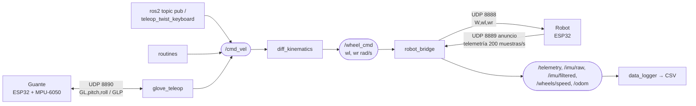

# Minisumo teleoperado con ROS2

Robot minisumo diferencial con **ESP32** (versión actual: ESP32 DevKit V1; la primera versión usó una ESP32-C3 Super Mini), controlado de forma inalámbrica desde un PC con **Linux y ROS2**, y un **guante** con ESP32 + MPU-6050 para manejarlo con la inclinación de la mano.

El robot lee una IMU y dos encoders a **200 muestras/s**, filtra las señales en el microcontrolador (IIR en la IMU, media móvil en las ruedas), cierra un **PID de velocidad por rueda** más un **control de rumbo con el giroscopio**, estima su posición (odometría con fusión encoders + giroscopio) y envía todos los datos, crudos y filtrados, al PC por UDP.

> El informe del proyecto está en [INFORME.md](INFORME.md).

---

## Arquitectura



| Nodo ROS2 | Función |
|---|---|
| `robot_bridge` | Encuentra el robot por su anuncio UDP, le envía la velocidad de cada rueda a 50 Hz y publica la telemetría en tópicos ROS2 |
| `diff_kinematics` | Modelo cinemático del robot diferencial: `/cmd_vel` (v, ω) → `/wheel_cmd` (ω izquierda, ω derecha) |
| `data_logger` | Guarda toda la telemetría (cruda y filtrada) en un CSV |
| `routines` | Ejecuta rutinas de movimiento conocidas y compara la posición final deseada con la estimada |
| `glove_teleop` | Convierte la inclinación del guante en `/cmd_vel` |

---

## Estructura del repositorio

```
minisumo/
├── firmware/
│   ├── robot_esp32/    # robot, versión actual: ESP32 DevKit V1 + batería 3S (ESP-IDF 5.3.1)
│   ├── robot/          # robot, primera versión: ESP32-C3 Super Mini + batería 2S
│   └── guante/         # ESP32 DevKit + MPU-6050 (ESP-IDF 5.3.1)
├── pcb/                # PCB del robot para la ESP32 DevKit (KiCad 10)
├── ros2/
│   └── minisumo_ros/   # paquete ROS2 (Python, ament_python)
├── docs/
│   └── cableado.html   # diagrama de conexiones físicas
├── README.md
└── INFORME.md
```

---

## Hardware

### Robot, versión actual (`firmware/robot_esp32`)

| Componente | Uso |
|---|---|
| ESP32 DevKit V1 (30 pines) | Control, filtrado, rumbo, WiFi; solo se usa la fila derecha de pines |
| MPU-6050 (clon) | Acelerómetro y giroscopio |
| TB6612FNG | Puente H (VM máximo 13,5 V) |
| 2 motorreductores TT + ruedas de 65 mm | Tracción diferencial |
| 2 encoders de herradura (LM393) + discos de 20 ranuras | Se cuenta solo el flanco de subida: 20 pulsos por vuelta |
| Batería 3S (11,1–12,6 V) | Motores; el PWM se limita a 0,55 (~6,5 V en los motores de 6 V) |
| Condensador cerámico de 100 nF en cada motor | Reduce el ruido que los motores inducen en los encoders |

**Pines de la ESP32 DevKit (cableado actual)**

| Señal | GPIO | Señal | GPIO |
|---|---|---|---|
| PWMA (motor izquierdo) | 5 | PWMB (motor derecho) | 23 |
| AIN1 | 18 | BIN1 | 17 |
| AIN2 | 19 | BIN2 | 16 |
| Encoder izquierdo (D0) | 4 | Encoder derecho (D0, 1 kΩ en serie) | 15 |
| SDA (MPU-6050) | 21 | SCL (MPU-6050) | 22 |
| LED de la placa (WiFi conectado) | 2 | Libres (programación y monitor) | 1, 3 |

> La PCB de `pcb/` usa otra asignación de pines, pensada para rutear sin cruces: PWMA 23, AIN2 22, AIN1 21, BIN1 19, BIN2 18, PWMB 5, ENC_L 17, SCL 16, SDA 4, ENC_R 15. Al montar el robot en la PCB hay que cambiar los pines en `config.h`.

**Control con batería 3S.** Con 3S los encoders todavía cuentan pulsos falsos cuando los motores toman corriente, y el PID de cada rueda, persiguiendo esas lecturas, hacía zigzaguear al robot. Por eso el PID de rueda está apagado (`PID_KP` y `PID_KI` en 0): la velocidad la da la prealimentación (modelo del motor medido con 3S) y el **control de rumbo con el giroscopio** mantiene la dirección. Probado hasta 30 rad/s por rueda (~1 m/s) con menos de 6° de desvío. Para volver a usar el PID de rueda hay que filtrar los D0 en hardware (10 nF del pin a GND junto a la ESP32).

### Robot, primera versión (`firmware/robot`)

| Componente | Uso |
|---|---|
| ESP32-C3 Super Mini | Control, filtrado, PID, WiFi |
| MPU-6050 (clon, WHO_AM_I = 0x70) | Acelerómetro ±4 g y giroscopio ±500 °/s |
| TB6612FNG | Puente H de los dos motores |
| 2 motorreductores TT + ruedas de 65 mm | Tracción diferencial |
| 2 sensores de herradura (LM393) + discos de 20 ranuras | Encoders de un canal, 40 flancos por vuelta |
| LM2596 | Regulador de la lógica |
| Diodo 1N5819 | Evita que el USB y el LM2596 se alimenten entre sí |
| LiPo 2S 7,4 V | Batería |
| Capacitores 470 µF en VM, 103 en cada motor, 102 en VM | Filtrado de la alimentación de los motores |

**Pines del ESP32-C3**

| Señal | GPIO | Señal | GPIO |
|---|---|---|---|
| PWMA (motor izquierdo) | 5 | PWMB (motor derecho) | 10 |
| AIN1 | 6 | BIN1 | 20 |
| AIN2 | 7 | BIN2 | 21 |
| Encoder izquierdo (D0) | 3 | Encoder derecho (D0) | 4 |
| SDA (MPU-6050) | 8 | SCL (MPU-6050) | 9 |

- STBY del TB6612 a 3,3 V.
- Encoders y MPU-6050 alimentados a 3,3 V.
- VM del TB6612 directo a la batería.
- La consola del ESP va por el USB nativo, porque GPIO20 y 21 (UART0) se usan para el motor derecho.

El diagrama completo está en [docs/cableado.html](docs/cableado.html).

### Guante (ESP32 DevKit)

| MPU-6050 | ESP32 |
|---|---|
| VCC | 3V3 |
| GND | GND |
| SDA | GPIO21 |
| SCL | GPIO22 |
| AD0 | GND |

- **LED de la placa (GPIO2):** encendido cuando el guante está conectado al WiFi.
- **Botón BOOT (GPIO0):** fija la posición actual de la mano como la neutra.
- **Monitor serie:** 5 líneas por segundo con el cabeceo y el alabeo (absoluto, respecto al neutro y solo con acelerómetro), la temperatura del MPU y si envía directo al PC o por broadcast.

---

## Puesta en marcha

### 1. Credenciales del WiFi

El robot, el guante y el PC deben estar en la **misma red**. En cada firmware, copia la plantilla y escribe tu red:

```bash
cp firmware/robot_esp32/main/wifi_secrets.example.h firmware/robot_esp32/main/wifi_secrets.h
cp firmware/guante/main/wifi_secrets.example.h      firmware/guante/main/wifi_secrets.h
```

`wifi_secrets.h` está en `.gitignore`, así que nunca se sube al repositorio.

### 2. Firmware (ESP-IDF 5.3.1)

```bash
cd firmware/robot_esp32     # o firmware/guante
idf.py build flash monitor
```

- Cada firmware trae su objetivo configurado en `sdkconfig.defaults` (`esp32` para el robot actual y el guante, `esp32c3` para la primera versión del robot).
- Si la placa no entra sola en modo de programación (`Wrong boot mode detected`), mantén presionado **BOOT** mientras carga.
- **Al encender cualquiera de los dos, déjalo quieto unos 2–3 s:** en ese tiempo calibra el giroscopio.

### 3. Paquete ROS2

```bash
mkdir -p ~/ros2_ws/src
cp -r ros2/minisumo_ros ~/ros2_ws/src/
cd ~/ros2_ws && colcon build --symlink-install && source install/setup.bash
```

Si el firewall está activo, abre los puertos UDP:
```bash
sudo ufw allow 8888:8890/udp
```

---

## Uso

En cada terminal: `cd ~/ros2_ws && source install/setup.bash`.

```bash
ros2 run minisumo_ros robot_bridge --ros-args -p cmd_timeout:=1.0     # espera hasta ver ~200 muestras/s
ros2 run minisumo_ros diff_kinematics --ros-args -p omega_max:=30.0  # hasta 30 rad/s por rueda (~0,95 m/s)
```

### Movimiento manual

```bash
# adelante 0,15 m/s
ros2 topic pub -r 20 /cmd_vel geometry_msgs/msg/Twist "{linear: {x: 0.15}}" > /dev/null
# atrás
ros2 topic pub -r 20 /cmd_vel geometry_msgs/msg/Twist "{linear: {x: -0.15}}" > /dev/null
# girar en el sitio a la izquierda (z > 0) o a la derecha (z < 0)
ros2 topic pub -r 20 /cmd_vel geometry_msgs/msg/Twist "{angular: {z: 3.0}}" > /dev/null
```

- **Velocidad máxima probada:** `x` = 0,95 m/s (30 rad/s por rueda). La rampa tarda 1,2 s en llegar, así que hace falta espacio.
- **Directo por rueda (rad/s):** `ros2 topic pub -r 20 /wheel_cmd std_msgs/msg/Float32MultiArray "{data: [15.0, 15.0]}"`.
- Con Ctrl+C el robot se detiene solo en menos de 1 s.

### Guante

```bash
ros2 run minisumo_ros glove_teleop --ros-args -p v_max:=0.6 -p w_max:=4.0 -p max_deg:=30.0 \
    -p swap_axes:=true -p invert_pitch:=true -p invert_roll:=true
```

- **Adelante o atrás:** inclina la mano en esa dirección; con 30° va a la velocidad máxima.
- **Girar:** ladea la mano más de 12° (`roll_deadzone_deg`). Con la mano muy inclinada adelante o atrás el giro se atenúa y desaparece pasando 60°, porque ahí el alabeo pierde sentido.
- **Orientación del MPU en la mano:** `swap_axes` intercambia los ejes (si al inclinar adelante el robot gira), e `invert_pitch` / `invert_roll` invierten cada sentido. La línea de arriba corresponde al guante actual.
- **Antes de manejar,** presiona BOOT con la mano en reposo para fijar el cero.
- glove_teleop debe mostrar unos 50 paquetes/s. Si bajan, revisa que la mano no tape la antena de la ESP32.

### Registro de datos y rutinas

```bash
ros2 run minisumo_ros data_logger --ros-args -p nombre:=recta_v015
ros2 run minisumo_ros routines --ros-args -p rutina:=recta -p distancia:=0.5 -p iteraciones:=3
ros2 run minisumo_ros routines --ros-args -p rutina:=cuadrado -p distancia:=0.3
ros2 run minisumo_ros routines --ros-args -p rutina:=arco -p radio:=0.2
ros2 run minisumo_ros routines --ros-args -p rutina:=giro -p angulo:=90
```

- **Telemetría:** el registrador la guarda en `~/minisumo_datos/<nombre>_<fecha>.csv`.
- **Rutinas:** cada iteración agrega a `~/minisumo_datos/rutinas.csv` la posición deseada y la estimada. La real se mide con cinta y se escribe a mano.

---

## Protocolo UDP

### PC → robot (puerto 8888, una línea de texto por datagrama)

| Comando | Significado |
|---|---|
| `W,wl,wr` | Velocidad de cada rueda en rad/s (PID) |
| `M,dl,dr` | Ciclo útil directo en [-1, 1] (lazo abierto, para pruebas) |
| `S` | Detener |
| `P` | Mantener vivo sin cambiar la orden |
| `G,kp,ki,kd[,kff]` | Ganancias del PID de las ruedas |
| `F,dmin_l,dmin_r[,trim]` | Zona muerta de cada motor y corrección máxima del PID |
| `Y,kp,ki` | Control de rumbo con giroscopio (`Y,0,0` lo desactiva) |
| `R` | Reiniciar odometría y contadores |
| `C` | Recalibrar el giroscopio (robot quieto 2 s) |
| `H` | Pedir la cabecera de la telemetría |

- **Por seguridad**, si pasan 700 ms sin recibir comandos (300 ms en la primera versión), el robot detiene los motores.
- **Desde ROS2**, cualquier comando se puede enviar así:
```bash
ros2 topic pub --once /robot_cmd std_msgs/msg/String "{data: 'R'}"
```

### Robot → PC

| Mensaje | Puerto | Formato |
|---|---|---|
| Anuncio | 8889, broadcast, 1 Hz | `MINISUMO,<ip>,8888` |
| Telemetría | al puerto del último comando | 4 líneas `D,...` por paquete (200 muestras/s) |

**Columnas de la telemetría (30):**

```
t_ms, ax, ay, az, gx, gy, gz,                 IMU cruda (g, °/s)
ax_f, ay_f, az_f, gx_f, gy_f, gz_f,           IMU filtrada (IIR)
wl, wr, wl_f, wr_f,                           velocidad de las ruedas cruda y filtrada (rad/s)
wl_ref, wr_ref, duty_l, duty_r,               referencia y ciclo útil aplicado
ticks_l, ticks_r,                             flancos acumulados de los encoders
x, y, theta, theta_enc, theta_gyro,           odometría (m, rad)
filt_us, mode                                 tiempo de cómputo de los filtros, modo
```

### Guante ↔ PC (puerto 8890, 50 Hz)

```
GL,t_ms,pitch,roll,pitch_raw,roll_raw          guante -> PC: ángulos en grados respecto a la posición neutra
GLP                                            PC -> guante, cada 0,5 s: "envíame directo"
```

El guante empieza por broadcast. Cuando recibe `GLP` de glove_teleop, envía directo (unicast) a ese PC, y vuelve al broadcast si pasan 3 s sin aviso. Los hotspots de celular retienen o descartan los broadcast (llegaban 6–14 de 50 paquetes/s).

---

## Parámetros principales

### `firmware/robot_esp32/main/config.h` (versión actual, batería 3S)

| Grupo | Parámetros |
|---|---|
| Lazo | `CONTROL_HZ 200`, `CMD_TIMEOUT_MS 700`, `PWM_FREQ_HZ 20000`, `PWM_MAX 0.55`, rampa `REF_ACCEL_MAX 25` rad/s² |
| Encoders | `ENC_SLOTS 20`, solo flanco de subida, confirmación de 50 µs (`ENC_CONFIRM_US`), `ENC_OMEGA_PHYS_MAX 40` |
| Ruedas | prealimentación `PID_KFF 0.010`, zona muerta 0,10 (izquierda) y 0,09 (derecha); `PID_KP` y `PID_KI` en 0 |
| Rumbo (en cascada, sobre la velocidad pedida a cada rueda) | `YAW_KP 1.0`, `YAW_KI 17.5`, `YAW_CORR_MAX 7.5` rad/s, `GYRO_Z_SIGN +1` |
| Giroscopio | la calibración al arrancar se repite sola si el robot se movió (`GYRO_CAL_MAX_STD`) |

### `firmware/robot/main/config.h` (primera versión, batería 2S)

| Grupo | Parámetros |
|---|---|
| Lazo | `CONTROL_HZ 200`, `CMD_TIMEOUT_MS 300`, `PWM_FREQ_HZ 20000`, `PWM_MAX 0.70` |
| Encoders | `ENC_SLOTS 20`, ambos flancos, `ENC_DEBOUNCE_US 4000`, rechazo adaptativo de rebotes |
| PID de ruedas | `PID_KP 0.02`, `PID_KI 0.25`, `PID_KFF 0.02`, zona muerta 0,15 (izquierda) y 0,085 (derecha), `PID_TRIM 0.03` |
| Rumbo | `YAW_KP 0.08`, `YAW_KI 1.00`, `YAW_CORR_MAX 0.30`, `GYRO_Z_SIGN -1` |
| Filtros | IIR Butterworth de orden 2, fc = 20 Hz (`filter_coefs.h`); media móvil `MOVAVG_N 5` |
| Arranque suave | `MOTOR_SLEW_PER_S 3.0` |

---

## Problemas conocidos y soluciones

| Síntoma | Causa | Solución |
|---|---|---|
| Telemetría en 0/s y el monitor muestra `PC esperando` | El hotspot cambió de subred y la VM quedó con la IP vieja | `sudo nmcli networking off && sudo nmcli networking on` |
| `RTPS_TRANSPORT_SHM Error ... open_and_lock_file failed` | Quedaron archivos de memoria compartida de FastDDS de nodos cerrados con Ctrl+C | `ros2 daemon stop && rm -f /dev/shm/fastrtps_* /dev/shm/sem.fastrtps_*` (no afecta al robot) |
| Con batería el LED azul se apaga y vuelve en ciclos | Caída de voltaje al arrancar los motores (reinicio por brownout) | Alimentar el ESP aparte (power bank) o poner un diodo y 1000 µF antes del LM2596; resistencias de 10 kΩ de PWMA y PWMB a GND |
| Una rueda se queda quieta con orden de avanzar | Encoder con rebotes en el borde de una ranura | Ya resuelto en el firmware (piso de ciclo útil y rechazo de lecturas imposibles). Ajustar el potenciómetro del módulo y separar el cable D0 de los motores |
| El robot gira sobre una rueda con el control de rumbo activo | Signo del giroscopio invertido | `GYRO_Z_SIGN` en `config.h` |
| El puente encuentra al robot pero recibe 0 muestras/s | La VM quedó con una IP de otra red (`ping` responde desde 192.168…) | `nmcli networking off && nmcli networking on`, con la VM en modo puente sobre la tarjeta WiFi |
| El robot avanza y frena a tirones, y cada vez se desvía hacia un lado distinto | Cortes de comandos por el WiFi del hotspot: al frenar se reinicia el control de rumbo | `CMD_TIMEOUT_MS 700` en el robot y `cmd_timeout:=1.0` en el puente; celular cargando, con la pantalla encendida y cerca |
| Zigzag con batería 3S | Los encoders cuentan pulsos falsos (hasta 4 veces lo real) y el PID de rueda los persigue | Condensadores de 100 nF en los motores, PID de rueda apagado y rumbo con el giroscopio (versión actual) |
| glove_teleop recibe pocos paquetes | Broadcast por un hotspot de celular, o la mano tapa la antena | Envío directo con `GLP` (ya incluido); antena de la ESP32 hacia afuera |
| Con el guante, al inclinar adelante el robot gira | MPU montado girado 90° | `swap_axes:=true` y ajustar `invert_pitch` / `invert_roll` |

---

## Licencia

MIT
